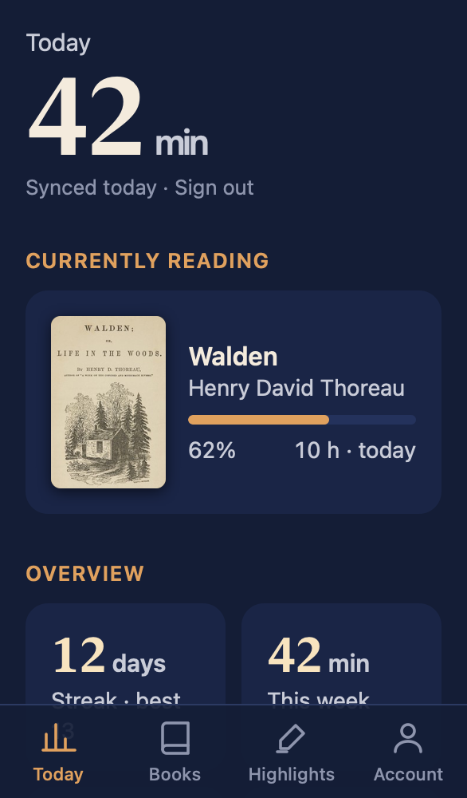
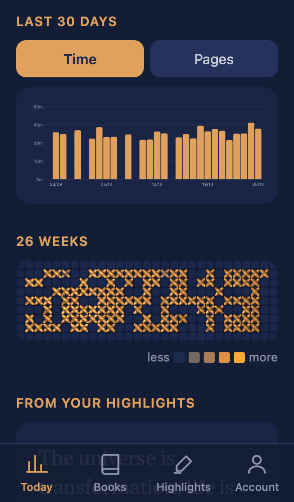
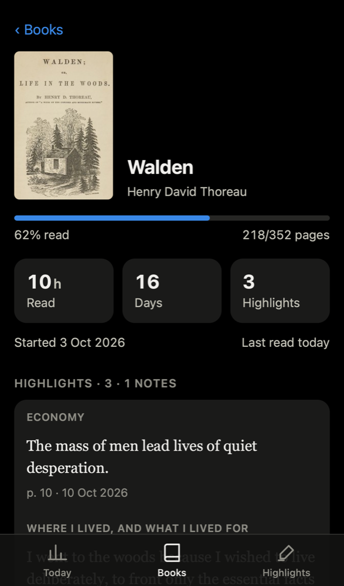
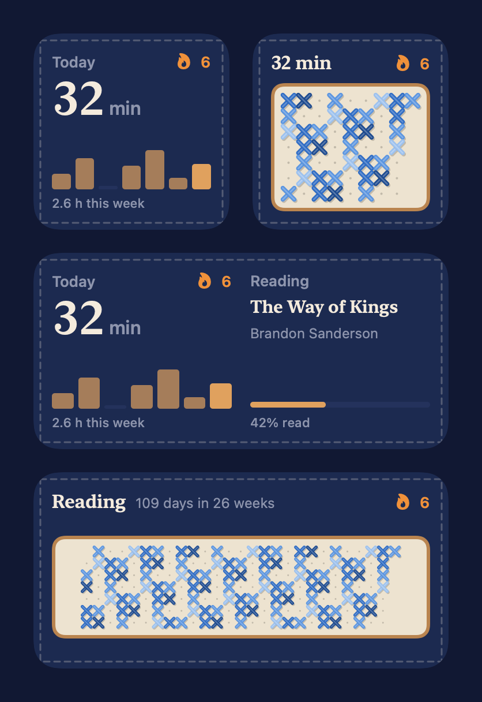

<p align="center">
  
</p>

<h1 align="center">reading-stats</h1>

<p align="center">
  <b>Your e-reader's reading time, streaks and highlights, on your phone.</b><br>
  A self-hosted companion for <a href="https://koreader.rocks">KOReader</a>, with a web app and iPhone widgets.
</p>

<p align="center">
  <a href="https://koreader.rocks"></a>
  
  
  
  <a href="LICENSE"></a>
</p>

<p align="center">
  <a href="#what-it-does">Features</a> ·
  <a href="#how-it-works">How it works</a> ·
  <a href="INSTALL.md">Install</a> ·
  <a href="#run-it-locally">Try it locally</a> ·
  <a href="PRIVACY.md">Privacy</a>
</p>

Your e-reader syncs to a small server you own, and you see everything on the web and in iPhone
widgets. One server can serve a whole household, with a separate account for each reader.

<p align="center">
  
  
  
</p>
<p align="center">
  
  
  
</p>

<p align="center"><sub>Screenshots use the demo library from <code>scripts/demo_data.py</code>.</sub></p>

## What it does

- **Today**: time read today, this week, month and year, your streak, the last 30 days and a
  26-week calendar, what you're reading now, and a highlight of the day.
- **Books**: covers (from Open Library), progress, time spent and days read per book.
- **Send to e-reader**: upload books on the Books tab, from a computer or a phone, and they land in
  an Inbox folder on the e-reader the next time it's online, like Send to Kindle. Books waiting to
  go out can be taken back; delivered ones are deleted from the server. On the e-reader, Tools →
  *Get books sent from the web* fetches them right away.
- **Highlights**: every highlight and note from KOReader, plus the stock Kindle reader's
  `My Clippings.txt`, grouped by book and chapter or by month, searchable by text, note, chapter,
  book or author (matches are marked), and narrowed with one Filter panel: type, source, book,
  date and grouping, shown as removable chips. One-word dictionary lookups are kept apart as
  Words. Export exactly what's shown, filters and search included, as an Excel spreadsheet.
- **iPhone**: an app that shows the site, and widgets for the Home Screen (today, current book,
  reading calendar) and the Lock Screen. Install it from
  [TestFlight](https://testflight.apple.com/join/KPEdXnF8) and enter your server's address.
  Exports open in the share sheet, to save to Files or send to another app.
- **No manual syncing**: highlights upload seconds after you make them, stats sync whenever Wi-Fi
  connects and every 30 minutes. Offline changes wait and go out later.
- **Several readers**: each person has their own account and sees only their own books, stats and
  highlights. Admins add people; everyone manages their own password, devices and sessions.

## How it works

```
e-reader (KOReader)                         your server (server.py)               you
──────────────────                          ───────────────────────               ───
Reading statistics ── statistics.sqlite3 ──▶ /dav/koreader/          ──▶ web app (/login, /)
highlightsync plugin ── highlights/*.json ─▶   (WebDAV, Basic auth)  ──▶ /api/widget ──▶ iOS widgets
Inbox folder ◀──────────── inbox/* ──────────                         ◀── Send to e-reader (web)
```

Every request is tied to one account, and `/dav/` is that account's own folder:

| Who | Signs in with |
|---|---|
| Browser / iPhone app | username and account password, at `/login` (a session cookie) |
| KOReader | username and a **device password** made on the account page; never the account password |
| iPhone widgets | a widget token the app gets for its phone when you sign in to it |

- `server.py`: standard library only. It is the WebDAV folder KOReader's built-in statistics
  sync writes to, and it serves the web app and its API from the same data.
- `auth.py`: accounts, sessions and device passwords, in `DATA_DIR/auth.sqlite3`.
- `account.html`, `admin.html`: the account page (password, devices, sessions) and the admin page
  (people).
- `koreader/highlightsync.koplugin`: a KOReader plugin that uploads highlights to the same
  WebDAV server, keeps statistics syncing in the background, and downloads the books sent from
  the web.
- `ios/`: a SwiftUI app and WidgetKit extension.

There is no shared service: you run the server, and data stays on a volume you control. A
household can share one server, with an account per reader.

## Install

Give [INSTALL.md](INSTALL.md) to a coding agent (or follow it yourself). It covers getting
KOReader onto the device, deploying the server to Railway, adding people, configuring each device
with `scripts/configure_koreader.py`, tidying books, building the iPhone app, and merging two
existing servers into one.

## Run it locally

```sh
scripts/demo_data.py ./demo-data
AUTH_PASSWORD=demo-password-123 DATA_DIR=./demo-data PORT=8080 python3 server.py
# open http://localhost:8080 and sign in as reader / demo-password-123
```

The first start turns `AUTH_PASSWORD` into the admin account `reader`. Add people from Account →
Admin.

## Configuration

| Variable | Purpose |
|---|---|
| `DATA_DIR` | Where data lives, default `/data`; mount a persistent volume there |
| `TZ_NAME` | Default IANA time zone for "today" and streaks, default `UTC`; each account can override it |
| `PORT` | Listen port, default `8080` |
| `AUTH_PASSWORD` | First start only: becomes the first admin's password (12+ characters) |
| `AUTH_USER` | First start only: the first admin's username, default `reader` |
| `WIDGET_TOKEN`, `USERS` | First start only: imports accounts from older versions (see below) |

The `AUTH_*`, `WIDGET_TOKEN` and `USERS` variables are read only while the accounts table is
empty. After that, accounts live in `DATA_DIR/auth.sqlite3` and the variables can be removed.

## Accounts

Admins manage people on the **admin page** (Account → Admin):

- **Add a person**: pick a username and time zone. They get a temporary password and must choose
  their own at first sign-in; until then they see only the account page.
- **Reset password**, **disable** (signs them out and stops their devices), **enable**, **delete**
  (keeps their reading data in `DATA_DIR/deleted/`), **make admin** / **remove admin**. There is
  always at least one admin, and nobody can disable or delete themselves.
- **New e-reader password** for someone, to set up their Kindle for them.

Everyone has an **account page**:

- **Password**: changing it signs out their other browsers and phones. E-readers and widgets keep
  working, since they use their own secrets.
- **E-readers**: device passwords for KOReader. Make one per device, revoke one if it's lost.
- **iPhone widgets**: one entry per phone, added when the Reading app signs in.
- **Signed in**: every browser and phone with a session; sign out any of them.

Where data lives:

| What | Where |
|---|---|
| Accounts, sessions, devices | `DATA_DIR/auth.sqlite3` |
| The first account's reading data | `DATA_DIR/dav` |
| Everyone else's reading data | `DATA_DIR/users/<name>/dav` |
| Cover cache (shared) | `DATA_DIR/covers` |
| Deleted accounts' data | `DATA_DIR/deleted/<name>-<time>` |

### Upgrading from environment-variable accounts

Older versions kept accounts in `AUTH_USER`/`AUTH_PASSWORD`/`WIDGET_TOKEN` and `USERS` (JSON:
`{"name": {"password": "...", "widget_token": "...", "tz": "..."}}`). On the first start of this
version they are imported: the `AUTH_USER` account becomes an admin, everyone keeps their
password and data folder, each old password also becomes that account's e-reader device password,
and each widget token becomes an iPhone device. Kindles and widgets set up before keep working.
Web sign-ins are new, so everyone signs in once more. Then change your password on the account
page, so the one your e-reader holds is no longer your account password.

## Security

- Account passwords are hashed with PBKDF2-SHA256 (600,000 iterations). Session cookies, device
  passwords and widget tokens are random and stored only as SHA-256 hashes, so a copy of
  `auth.sqlite3` doesn't reveal any of them.
- The browser signs in at `/login`; sessions are HttpOnly, Secure, SameSite=Lax cookies kept for
  180 days, listed on the account page and revocable one by one.
- Changing data needs a JSON request from the site itself: cross-site requests are refused.
- WebDAV uses Basic auth (KOReader's only option) with a device password; keep the server behind
  HTTPS. A device password can sync and read, but can't manage the account.
- Failed sign-ins are rate-limited per client, and slowed down for everyone when many fail at
  once. Sign-in takes the same time whether or not the username exists.
- Accounts can't see each other's data: WebDAV, the web app and widgets are scoped to the
  signed-in account, and WebDAV paths can't escape its folder.

## Privacy

The server and the iPhone app have no analytics, ads or tracking, and the app talks only to the
server you point it at. The server looks up book covers on Open Library by title and author. See [PRIVACY.md](PRIVACY.md).

## License

MIT, see [LICENSE](LICENSE).

<p align="center"><sub>Made for people who read on e-ink and like to see their streaks.</sub></p>
