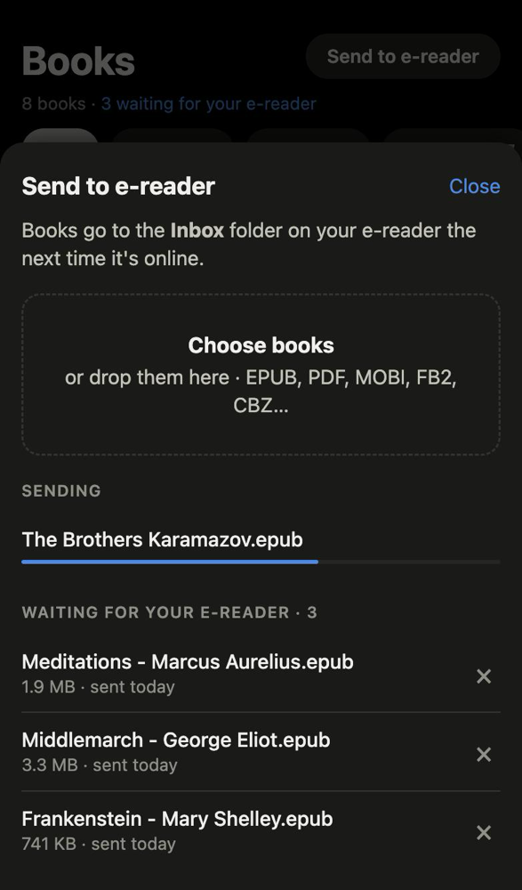
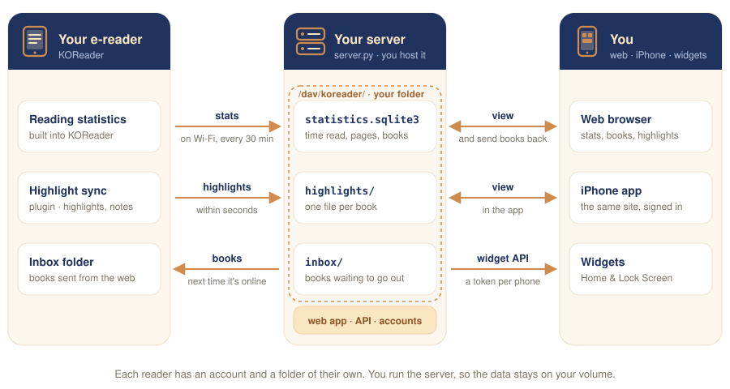

<p align="center">
  
</p>

<h1 align="center">reading-stats</h1>

<p align="center">
  <b>Your e-reader's reading time, streaks and highlights, on your phone.</b><br>
  A self-hosted companion for <a href="https://koreader.rocks">KOReader</a>, with a web app and iPhone widgets.
</p>

<p align="center">
  <a href="https://koreader.rocks"></a>
  
  
  
  <a href="LICENSE"></a>
</p>

<p align="center">
  <a href="#what-it-does">Features</a> ·
  <a href="#how-it-works">How it works</a> ·
  <a href="INSTALL.md">Install</a> ·
  <a href="#run-it-locally">Try it locally</a> ·
  <a href="https://testflight.apple.com/join/KPEdXnF8">iPhone app</a> ·
  <a href="PRIVACY.md">Privacy</a>
</p>

Your e-reader syncs to a small server you own, and you see everything on the web and in iPhone
widgets. One server can serve a whole household, with a separate account for each reader.

<p align="center">
  
  
  
  
</p>
<p align="center">
  
  
  
</p>

<p align="center"><sub>Screenshots use the demo library from <code>scripts/demo_data.py</code>.</sub></p>

## What it does

- **Today**: time read today, this week, month and year, your streak, the last 30 days and a
  26-week calendar, what you're reading now, and a highlight of the day.
- **Books**: covers (from Open Library), progress, time spent and days read per book.
- **Send to e-reader**: upload books on the Books tab, from a computer or a phone, and they land in
  an Inbox folder on the e-reader the next time it's online, like Send to Kindle. Books waiting to
  go out can be taken back; delivered ones are deleted from the server. On the e-reader, Tools →
  *Get books sent from the web* fetches them right away.
- **Highlights**: every highlight and note from KOReader, plus the stock Kindle reader's
  `My Clippings.txt`, grouped by book and chapter or by month, searchable by text, note, chapter,
  book or author (matches are marked), and narrowed with one Filter panel: type, source, book,
  date and grouping, shown as removable chips. One-word dictionary lookups are kept apart as
  Words. Export exactly what's shown, filters and search included, as an Excel spreadsheet.
- **iPhone**: an app that shows the site, and widgets for the Home Screen (today, current book,
  reading calendar) and the Lock Screen. Install it from
  [TestFlight](https://testflight.apple.com/join/KPEdXnF8) and enter your server's address.
  Exports open in the share sheet, to save to Files or send to another app.
- **No manual syncing**: highlights upload seconds after you make them, stats sync whenever Wi-Fi
  connects and every 30 minutes. Offline changes wait and go out later.
- **Several readers**: each person has their own account and sees only their own books, stats and
  highlights. Admins add people; everyone manages their own password, devices and sessions.

## How it works

<p align="center">
  
</p>

1. **You read.** KOReader's built-in statistics sync uploads `statistics.sqlite3` whenever Wi-Fi
   connects and every 30 minutes; the highlight sync plugin uploads each highlight seconds after
   you make it. Offline changes wait and go out later.
2. **Your server keeps it.** `server.py` is a WebDAV folder per account plus the web app and API,
   all from the same files. Nothing else stores your data.
3. **You look.** The web app, the iPhone app and the widgets all read from your server. Books you
   send from the web wait in `inbox/` until the e-reader downloads them into its Inbox folder.

Each part signs in its own way, so a lost e-reader never exposes your account password:

| Who | Signs in with |
|---|---|
| 🌐 Browser / iPhone app | username and account password, at `/login` (a session cookie) |
| 📖 KOReader | username and a **device password** made on the account page |
| 📱 iPhone widgets | a widget token the app gets for its phone when you sign in to it |

What's in the repo:

| Path | What it is |
|---|---|
| [`server.py`](server.py) | the server: WebDAV, web app and API. Python standard library only |
| [`auth.py`](auth.py) | accounts, sessions and device passwords, in `DATA_DIR/auth.sqlite3` |
| [`index.html`](index.html), [`account.html`](account.html), [`admin.html`](admin.html) | the web app, the account page and the admin page |
| [`koreader/highlightsync.koplugin`](koreader/highlightsync.koplugin) | the KOReader plugin: uploads highlights, keeps stats syncing, fetches books sent from the web |
| [`ios/`](ios) | the SwiftUI iPhone app and its WidgetKit widgets |
| [`scripts/`](scripts) | `configure_koreader.py` sets up an e-reader; `demo_data.py` makes the demo library |

## Install

Give [INSTALL.md](INSTALL.md) to a coding agent (or follow it yourself). It covers getting
KOReader onto the device, deploying the server to Railway, adding people, configuring each device
with `scripts/configure_koreader.py`, tidying books, and building the iPhone app.

## Run it locally

```sh
scripts/demo_data.py ./demo-data
AUTH_PASSWORD=demo-password-123 DATA_DIR=./demo-data PORT=8080 python3 server.py
# open http://localhost:8080 and sign in as reader / demo-password-123
```

The first start turns `AUTH_PASSWORD` into the admin account `reader`. Add people from Account →
Admin.

## Configuration

| Variable | Purpose |
|---|---|
| `DATA_DIR` | Where data lives, default `/data`; mount a persistent volume there |
| `TZ_NAME` | Default IANA time zone for "today" and streaks, default `UTC`; each account can override it |
| `PORT` | Listen port, default `8080` |
| `AUTH_PASSWORD` | First start only: becomes the first admin's password (12+ characters) |
| `AUTH_USER` | First start only: the first admin's username, default `reader` |

The `AUTH_*` variables are read only while the accounts table is empty. After that, accounts live
in `DATA_DIR/auth.sqlite3` and the variables can be removed.

## Accounts

Admins manage people on the **admin page** (Account → Admin):

- **Add a person**: pick a username and time zone. They get a temporary password and must choose
  their own at first sign-in; until then they see only the account page.
- **Reset password**, **disable** (signs them out and stops their devices), **enable**, **delete**
  (keeps their reading data in `DATA_DIR/deleted/`), **make admin** / **remove admin**. There is
  always at least one admin, and nobody can disable or delete themselves.
- **New e-reader password** for someone, to set up their Kindle for them.

Everyone has an **account page**:

- **Password**: changing it signs out their other browsers and phones. E-readers and widgets keep
  working, since they use their own secrets.
- **E-readers**: device passwords for KOReader. Make one per device, revoke one if it's lost.
- **iPhone widgets**: one entry per phone, added when the Reading app signs in.
- **Signed in**: every browser and phone with a session; sign out any of them.

Where data lives:

| What | Where |
|---|---|
| Accounts, sessions, devices | `DATA_DIR/auth.sqlite3` |
| The first account's reading data | `DATA_DIR/dav` |
| Everyone else's reading data | `DATA_DIR/users/<name>/dav` |
| Cover cache (shared) | `DATA_DIR/covers` |
| Deleted accounts' data | `DATA_DIR/deleted/<name>-<time>` |

## Security

- Account passwords are hashed with PBKDF2-SHA256 (600,000 iterations). Session cookies, device
  passwords and widget tokens are random and stored only as SHA-256 hashes, so a copy of
  `auth.sqlite3` doesn't reveal any of them.
- The browser signs in at `/login`; sessions are HttpOnly, Secure, SameSite=Lax cookies kept for
  180 days, listed on the account page and revocable one by one.
- Changing data needs a JSON request from the site itself: cross-site requests are refused.
- WebDAV uses Basic auth (KOReader's only option) with a device password; keep the server behind
  HTTPS. A device password can sync and read, but can't manage the account.
- Failed sign-ins are rate-limited per client, and slowed down for everyone when many fail at
  once. Sign-in takes the same time whether or not the username exists.
- Accounts can't see each other's data: WebDAV, the web app and widgets are scoped to the
  signed-in account, and WebDAV paths can't escape its folder.

## Privacy

The server and the iPhone app have no analytics, ads or tracking, and the app talks only to the
server you point it at. The server looks up book covers on Open Library by title and author. See [PRIVACY.md](PRIVACY.md).

## License

MIT, see [LICENSE](LICENSE).

<p align="center"><sub>Made for people who read on e-ink and like to see their streaks.</sub></p>
